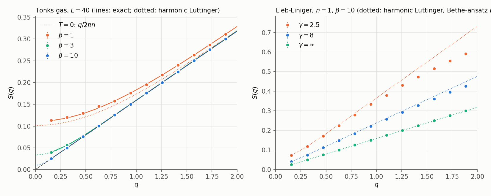

# Worm-algorithm path-integral Monte Carlo for bosons — technical documentation

This document describes the physical models, the method, the implementation (CPU and CUDA), how to run it, the demos, the validation against exact results, and the performance measurements. All formulas below are the ones implemented in `worm_pimc.cpp` and `worm_pimc_gpu.cu`.

**Contents**

1. [Models](#1-models)
2. [Path-integral representation](#2-path-integral-representation)
3. [The worm algorithm](#3-the-worm-algorithm)
4. [Estimators](#4-estimators)
5. [Exact reference solutions](#5-exact-reference-solutions)
6. [GPU implementation](#6-gpu-implementation)
7. [Usage](#7-usage)
8. [Demos](#8-demos)
9. [Validation](#9-validation)
10. [Performance](#10-performance)
11. [Limitations and outlook](#11-limitations-and-outlook)
12. [References](#12-references)

---

## 1. Models

We consider $N$ identical bosons of mass $m$ in $d = 1, 2, 3$ dimensions (compile-time `DIM`):

```math
H \;=\; -\lambda \sum_{i=1}^{N} \nabla_i^2 \;+\; \sum_{i=1}^{N} V_{\rm ext}(\mathbf r_i) \;+\; \sum_{i \lt j} v\big(\lvert\mathbf r_i - \mathbf r_j\rvert\big),
\qquad \lambda = \frac{\hbar^2}{2m}.
```

The default is $\hbar = m = 1$, that is $\lambda = 1/2$ (parameter `lam`).

**External potential** (parameter `omega`, $V_{\rm ext} = 0$ when `omega=0`):

```math
V_{\rm ext}(\mathbf r) = \tfrac12\,\omega^2 r^2 .
```

**Disorder** (parameters `Vd`, `qc`, `dseed`; off when `Vd=0`). A smooth random potential, periodic in the box, is added to $V_{\rm ext}$ along each axis:

```math
V_{\rm dis}(x) = V_d\sqrt{\frac{2}{M}}\sum_{k=1}^{M}\cos\!\Big(\frac{2\pi k x}{L} + \phi_k\Big),
\qquad M = \Big\lfloor \frac{q_c L}{2\pi}\Big\rfloor .
```

- All modes up to the wavevector $q_c$ have the same amplitude, so the statistics of the disorder do not depend on $L$; the correlation length is about $1/q_c$.
- The phases $\phi_k$ are uniform in $[0, 2\pi)$. They come from a splitmix64 generator seeded with `dseed`, so the CPU code, the GPU code and `exact_disorder.py` build the same realisation.
- The spatial variance of every realisation is exactly $V_d^2$.
- It is evaluated as $\mathrm{Re}\sum_k c_k z^k$ with $z = e^{2\pi i x/L}$ (Horner's rule): one sine/cosine and $M$ complex multiply-adds per call.

**Pair potentials** (parameter `pot`):

| `pot` | potential | parameters |
|---|---|---|
| 0 | harmonic coupling $v(r) = \tfrac12 \kappa r^2$ | `kappa` (no pair term if `kappa=0`) |
| 1 | Lennard-Jones $v(r) = 4\varepsilon\left[(\sigma/r)^{12} - (\sigma/r)^6\right]$ | `eps`, `sig` |
| 2 | Aziz HFDHE2 for ⁴He (K, Å) | built in; use `lam=6.0596` K Ų |
| 3 | contact $`v(x) = g\,\delta(x)`$, 1D only (Lieb–Liniger), with the exact pair-product action | `g` ($g \lt 0$: hard core, $g = \infty$) |

The Aziz HFDHE2 potential [5] is

```math
v(r) = \epsilon\left[A\,e^{-\alpha x} - F(x)\left(\frac{C_6}{x^6} + \frac{C_8}{x^8} + \frac{C_{10}}{x^{10}}\right)\right],
\qquad x = \frac{r}{r_m},
\qquad F(x) = \begin{cases} e^{-(D/x - 1)^2} & x \lt D \\ 1 & x \ge D \end{cases}
```

with $\epsilon = 10.8$ K, $r_m = 2.9673$ Å, $A = 0.5448504\times10^6$, $\alpha = 13.353384$, $D = 1.241314$, $C_6 = 1.3732412$, $C_8 = 0.4253785$ and $C_{10} = 0.1781$.

All pair potentials 0–2 are **truncated** (not shifted) at the cutoff `rc`: $v(r) = 0$ for $r \gt r_c$. No tail corrections are applied.

**Contact interaction** (`pot=3`, CPU, `DIM=1`). A δ potential cannot be sampled with the primitive approximation. Instead, every pair of links $i, j$ on the same slice carries the exact two-body action $e^{-u}$, the ratio of the interacting to the free relative propagator. With $r$ and $r'$ the relative coordinate $x_i - x_j$ at the two ends of the link (followed continuously along the link), $D = 2\lambda$ and $\kappa = g/2D$:

```math
e^{-u(r, r';\tau)} = 1 - \kappa\sqrt{\pi D\tau}\; e^{-(\lvert r\rvert\lvert r'\rvert + r r')/2D\tau}\; \mathrm{erfcx}\!\left(\frac{\lvert r\rvert + \lvert r'\rvert + 2\kappa D\tau}{2\sqrt{D\tau}}\right).
```

- The exponential is 1 when the pair crosses during the link ($r r' \lt 0$) and $e^{-\lvert r\rvert\lvert r'\rvert/D\tau}$ otherwise.
- Hard core ($g = \infty$, Tonks–Girardeau, `g=-1`): $e^{-u} = 1 - e^{-\lvert r r'\rvert/D\tau}$ if the pair does not cross, and 0 if it does.
- The action is exact for two particles, so the only discretisation error is from three-body collisions within one slice. It is much smaller than the primitive $O(\tau^2)$ error (Section 9.7).
- Energy: the potential part of the thermodynamic estimator is $\frac1\beta\sum \partial u/\partial\tau$ over all pair links. The interaction energy $\langle g\sum_{i\lt j}\delta(x_i - x_j)\rangle$ is reported as `Vbar` $= \frac{g}{\beta}\sum\partial u/\partial g$. Both derivatives are central differences.

**Boundary conditions.** Two options:

- **Open space** (`pbc=0`). This is typically combined with the trap. `Lbox` then only defines the region where Insert places new worms.
- **Periodic cubic box** of side $L$ = `Lbox` (`pbc=1`). The minimum-image convention applies to every pair distance and every imaginary-time link, and $r_c \le L/2$ is required.

---

## 2. Path-integral representation

**Grand partition function.** In the grand-canonical ensemble at temperature $T = 1/\beta$ and chemical potential $\mu$,

```math
\Xi = \sum_{N} \frac{e^{\beta\mu N}}{N!} \sum_{\mathcal P\in S_N} \int d\mathbf R\; \langle \mathbf R \,|\, e^{-\beta H} \,|\, \mathcal P \mathbf R\rangle ,
```

where $\mathcal P$ runs over the permutations of the particle labels.

**Primitive approximation.** Imaginary time is split into $P$ slices of width $\tau = \beta/P$ (parameter `P`), and each short-time density matrix is replaced by

```math
\rho(\mathbf R, \mathbf R'; \tau) \;\approx\; \prod_i \rho_0(\mathbf r_i, \mathbf r'_i; \tau)\; e^{-\tau V(\mathbf R)} ,
\qquad
\rho_0(\mathbf r, \mathbf r'; t) = (4\pi\lambda t)^{-d/2} \exp\!\left[-\frac{|\mathbf r - \mathbf r'|^2}{4\lambda t}\right],
```

with a systematic error of $O(\tau^2)$ in thermodynamic averages [2].

**Configurations.** A configuration is a set of *beads*. Each bead lives on a time slice $k \in \lbrace 0,\dots,P-1\rbrace$, carries a position, and is joined by *links* to a predecessor on slice $k-1$ and a successor on slice $k+1$ (indices mod $P$). Closed chains of links are the worldlines; a worldline winding $n$ times around imaginary time represents an exchange cycle of $n$ particles.

**Configuration weight.** The weight of a configuration $X$ is

```math
W(X) = C^{\,[X\in G]}\; \prod_{\text{beads}} e^{\mu\tau}\; \prod_{\text{links}} \rho_0(\Delta\mathbf r; \tau)\; \prod_{k=0}^{P-1} e^{-\tau V_k},
\qquad
V_k = \sum_{b\in k} V_{\rm ext}(\mathbf r_b) + \sum_{\substack{b \lt b'\\ b,b'\in k}} v(\lvert\mathbf r_b-\mathbf r_{b'}\rvert).
```

In the sector of closed worldlines (the **Z sector**) the number of beads is $N_b = NP$, so $\prod e^{\mu\tau} = e^{\beta\mu N}$ and $W$ is the primitive-approximation integrand of $\Xi$.

---

## 3. The worm algorithm

The worm algorithm of Boninsegni, Prokof'ev and Svistunov [1,2] enlarges the configuration space with a **G sector**. A G configuration contains exactly one open worldline (the *worm*) running from the *tail* (Masha, $\mathcal M$: no predecessor) to the *head* (Ira, $\mathcal I$: no successor), in addition to any number of closed worldlines.

- The G sector carries the arbitrary weight factor $C$ (parameter `C`). Its configurations sample the one-body Matsubara Green function.
- **All averages are taken in the Z sector.** $C$ only tunes the fraction of time spent in Z, $Z_{\rm frac}$ (printed as `Zfrac`); a value of 0.05–0.5 is efficient.
- Permutation sampling is local and ergodic: exchange cycles are built by the Swap move while the worm is open, and particle-number fluctuations come from Insert/Remove and Advance/Recede.

### 3.1 Moves and acceptance probabilities

**Move selection.** At each step one of 12 options is chosen with equal probability:

- Open, Close, Insert, Remove;
- Advance and Recede, for the head and for the tail separately (4 options);
- Swap;
- Staging (3 of the 12 options).

The two members of every complementary pair have the same selection probability, so selection probabilities cancel in the acceptance ratios.

**Notation.**

- $\Delta V_{\rm new}$ ($\Delta V_{\rm old}$) is the potential energy of the beads that are added (removed). Each bead contributes $`U(b) = V_{\rm ext}(\mathbf r_b) + \sum_{b'\in k_b,\, b'\ne b} v(\lvert \mathbf r_b - \mathbf r_{b'}\rvert )`$, and for a re-sampled segment the difference new − old is used.
- $\bar\rho_0$ is the image-summed free propagator (Section 3.2). Without pbc, $\bar\rho_0 = \rho_0$.
- Acceptance is $A = \min(1, \cdot)$ of the quantities below.

| Move | Proposal | Acceptance ratio |
|---|---|---|
| **Open** (Z→G) | Pick a bead $\mathcal I$ uniformly among the $N_b$ beads and $m\in\lbrace 1,\dots,L_{\max}\rbrace$ uniformly; delete the $m-1$ beads following $\mathcal I$. The bead $m$ links ahead becomes the tail $\mathcal M$. | $`\dfrac{C\, N_b\, L_{\max}\; e^{-(m-1)\mu\tau}\; e^{+\tau\Delta V_{\rm old}}}{\bar\rho_0(\mathbf r_{\mathcal I}, \mathbf r_{\mathcal M}; m\tau)}`$ |
| **Close** (G→Z) | Allowed if the slice gap $g$ from $\mathcal I$ to $\mathcal M$ is $\le L_{\max}$. Choose a periodic image of $\mathcal M$ with probability $\propto \rho_0$, then generate the $g-1$ beads with a Lévy bridge. | $`\dfrac{\bar\rho_0(\mathbf r_{\mathcal I}, \mathbf r_{\mathcal M}; g\tau)\; e^{(g-1)\mu\tau}\; e^{-\tau\Delta V_{\rm new}}}{C\, N_b'\, L_{\max}}`$, with $N_b'$ the number of beads after closing |
| **Insert** (Z→G) | Uniform slice ($P$ choices); $\ell \in\lbrace 0,\dots,L_{\max}-1\rbrace$ links uniformly; first bead uniform in the box of volume $V=L^d$; the remaining $\ell$ beads by free Gaussian steps. | $`C\, V\, P\, L_{\max}\; e^{(\ell+1)\mu\tau}\; e^{-\tau\Delta V_{\rm new}}`$ |
| **Remove** (G→Z) | Only if the worm has $\le L_{\max}$ beads and the tail lies inside the box; delete the whole worm. | inverse of Insert, with $\Delta V_{\rm old}$ |
| **Advance** (head or tail) | $m\in\lbrace 1,\dots,L_{\max}\rbrace$ new beads by free Gaussian steps from the head (forward) or the tail (backward). | $`e^{m\mu\tau}\, e^{-\tau\Delta V_{\rm new}}`$ |
| **Recede** (head or tail) | Delete $m\in\lbrace 1,\dots,L_{\max}\rbrace$ beads from the head or tail; the worm must keep at least one bead. | $`e^{-m\mu\tau}\, e^{+\tau\Delta V_{\rm old}}`$ |
| **Swap** | Choose $m\in\lbrace 1,\dots,L_{\max}\rbrace$. The candidates $\Omega$ are the beads $j$ on slice $k_{\mathcal I}+m$ whose $m$-th predecessor $q$ exists. Pick $j$ with probability $\bar\rho_0(\mathbf r_{\mathcal I},\mathbf r_j;m\tau)/\Sigma_{\mathcal I}$; delete the $m-1$ beads between $q$ and $j$; bridge $\mathcal I \to j$; $q$ becomes the new head. | $`\dfrac{\Sigma_{\mathcal I}}{\Sigma_q}\, e^{-\tau(\Delta V_{\rm new} - \Delta V_{\rm old})}`$, where $\Sigma_x = \sum_{j\in\Omega} \bar\rho_0(\mathbf r_x, \mathbf r_j; m\tau)$ |
| **Staging** (any sector) | Pick a random bead $a$ and $m\in\lbrace 2,\dots,L_{\max}\rbrace$ links; the segment must not contain the head. Re-sample the $m-1$ interior beads with a Lévy bridge, keeping both endpoints and the segment's end-to-end displacement. | $e^{-\tau(\Delta V_{\rm new} - \Delta V_{\rm old})}$ |

In every move the kinetic weight cancels exactly against the proposal density; only potential energy, chemical potential and normalisations remain. For Insert and Advance, the free Gaussian steps reproduce $\prod\rho_0$. For bridges, see below.

**Lévy bridge** [3]. The $m-1$ interior points between $\mathbf a$ (slice 0) and the endpoint $\mathbf b$ (slice $m$) are generated sequentially:

```math
\mathbf r_j = \mathbf r_{j-1} + \frac{\mathbf b - \mathbf r_{j-1}}{m-j+1} + \sqrt{2\lambda\tau\,\frac{m-j}{m-j+1}}\;\boldsymbol\xi_j,
\qquad \boldsymbol\xi_j \sim \mathcal N(0, 1)^d .
```

The joint density of the bridge is $`\prod_{\rm links}\rho_0 \,/\, \rho_0(\mathbf b - \mathbf a; m\tau)`$.

### 3.2 Periodic boundary conditions

With pbc every link displacement is taken as the minimum image. This requires $\sqrt{2\lambda\tau} \ll L/2$.

The displacement over $m \le L_{\max}$ links, however, need not be small compared with $L$. Its periodic images then all contribute. The code therefore uses the image-summed propagator, which factorises over Cartesian components:

```math
\bar\rho_0(\mathbf r, \mathbf r'; t) = \prod_{\alpha=1}^{d} \frac{1}{\sqrt{4\pi\lambda t}} \sum_{n=-2}^{2} \exp\!\left[-\frac{(x_\alpha + nL)^2}{4\lambda t}\right],
\qquad x_\alpha = \mathrm{mimg}(r'_\alpha - r_\alpha).
```

- **Close and Swap** pick the image $n$ of each component with probability $\propto$ its term, and then build the bridge towards that unwrapped point. The probability of proposing a given path is then $\prod\rho_0(\text{links}) / \bar\rho_0$, which is why $\bar\rho_0$ appears in the acceptance ratios of Open, Close and Swap.
- **Staging** keeps the *actual* end-to-end displacement of the old segment, i.e. the sum of its minimum-image links. Staging therefore never changes the winding number, and the move stays symmetric.

An earlier version used only the nearest image. It violated detailed balance whenever $\sqrt{2\lambda m\tau}$ was not negligible against $L/2$: for the 3D ideal gas at $\beta=2$, $L=3$ it gave $E = 1.69$, against the exact $0.142$. Sections 3.2 and 9.2 document the fix and its validation.

---

## 4. Estimators

All estimators are accumulated in the Z sector every `meas` steps.

| Quantity | Estimator |
|---|---|
| Particle number | $N = N_b / P$ |
| Potential energy | $\bar V = \frac1P\sum_{k} V_k$ |
| Thermodynamic energy | $`E = \frac{1}{P}\left[\frac{d\,N_b}{2\tau} - \sum_{\rm links}\frac{\lvert\Delta\mathbf r\rvert^2}{4\lambda\tau^2}\right] + \bar V`$ |
| Winding | $\mathbf D = \sum_{\rm links}\Delta\mathbf r$ (minimum image), reported as $D^2 = \lvert\mathbf D\rvert^2$ |
| Superfluid fraction | $`\rho_s/\rho = \dfrac{\langle D^2\rangle}{2\lambda\, d\,\beta\,\langle N\rangle}`$ |
| Exchange cycles | $n_j$ = number of particles in permutation cycles of length $j$, for $j = 1,\dots,11$; the last bin collects $j\ge12$, and $\sum_j n_j = N$ |
| Number fluctuations | $`\langle\delta N^2\rangle = \langle N^2\rangle - \langle N\rangle^2`$ |
| Winding number | $`\langle W^2\rangle = \langle D^2\rangle/(d L^2)`$ (per axis) |
| Luttinger parameter (1D) | $`K = \pi\sqrt{\langle W^2\rangle\,\langle\delta N^2\rangle}`$ |
| Static structure factor (CPU, `nsq`) | $`S(q) = \langle\lvert\rho_q\rvert^2\rangle/\langle N\rangle`$, $`\rho_q = \sum_{b\in k} e^{iqx_b}`$ averaged over slices $k$, $q = 2\pi m/L$ along $x$; connected $`S_c(q) = (\langle\lvert\rho_q\rvert^2\rangle - \lvert\langle\rho_q\rangle\rvert^2)/\langle N\rangle`$ |

**Energy.** The thermodynamic estimator is $-\partial_\beta$ of $\ln W$ at fixed $P$ and fugacity. In the Z sector the number of links equals $N_b$, so its average equals the internal energy of the discretised system *exactly* (no Trotter error relative to the PA reference).

**Exchange cycles.** A closed worldline of $j$ particles has $jP$ beads and crosses slice 0 exactly $j$ times. The estimator walks the loop from every bead of slice 0 and adds 1 to bin $j = \ell/P$, where $\ell$ is the number of beads in the loop, so each cycle of length $j$ contributes $j$ to $n_j$. The number of bins is the compile-time constant `NCYC` = 12.

**Superfluid fraction.** This is the Pollock–Ceperley winding-number estimator [4], $\rho_s/\rho = m\langle W^2\rangle L^2/(d\hbar^2\beta N)$ with $\mathbf D = L\mathbf W$. In the grand-canonical ensemble the ratio of averages is used.

**Luttinger parameter.** In 1D, with $\hbar = 1$, the superfluid stiffness and the compressibility are $`\Upsilon_s = L\langle W^2\rangle/\beta`$ and $`\kappa = \beta\langle\delta N^2\rangle/L`$. Then $`K = \pi\sqrt{\Upsilon_s\kappa}`$ reduces to the formula in the table, which does not depend on $\lambda$ or on the units.

- For a Luttinger liquid, $W$ and $N$ are discrete Gaussians with variances $`\sigma_W^2 = K\beta v/\pi L`$ and $`\sigma_N^2 = K L/\pi\beta v`$, where $v$ is the sound velocity.
- When both are wide, the formula gives $K$ at any temperature and size.
- Otherwise the discreteness matters, and the reported number is a finite-size estimate: invert the discrete-Gaussian forms of $\langle W^2\rangle$ and $\langle\delta N^2\rangle$ separately.
- With disorder, $\langle W^2\rangle$ and $\langle\delta N^2\rangle$ are averaged over realisations before $K$ is formed.

**Theta-function inversion ($K_{\rm th}$).** When $\langle W^2\rangle$ or $\langle\delta N^2\rangle$ is small, the zero modes are discrete Gaussians:

```math
P(N) \propto e^{-a(N-\nu)^2}, \qquad P(W) \propto e^{-bW^2}, \qquad a = \frac{\pi\beta v}{2KL}, \qquad b = \frac{\pi L}{2K\beta v}, \qquad K_{\rm th} = \frac{\pi}{2\sqrt{ab}} .
```

- The CPU code prints the Z-sector histograms of $N$ and of the winding number (lines `HISTN` and `HISTW`).
- `validation/lutt_combine.py` fits $a$, $\nu$ and $b$ by maximum likelihood on the histograms pooled over seeds, or from the moments, and bootstraps over seeds for the error.
- $K_{\rm th}$ is independent of $v$ and needs no wide distributions. For the Tonks gas of Section 9.7, $K_{\rm G} = \pi\sqrt{\langle W^2\rangle\langle\delta N^2\rangle}$ is 0.26 while the exact $K_{\rm th}$ is 1.0006.

**Statistical errors.**

- **CPU:** the production run is split into `blocks` consecutive blocks.
- **GPU:** the replicas are split into `blocks` groups. Replicas are independent, so the groups are uncorrelated by construction.
- In both cases every average is a ratio estimator $\sum O / \sum n_Z$, and errors (including that of the derived $\rho_s/\rho$) come from a delete-one jackknife over blocks or groups.

---

## 5. Exact reference solutions

### 5.1 Harmonic trap with harmonic pair coupling (`exact_pa.py`)

**Normal modes.** For $V_{\rm ext} = \frac12\omega^2 r^2$ and $v = \frac12\kappa r^2$ the Hamiltonian is quadratic. It has a centre-of-mass mode of frequency $\omega$ and $N-1$ relative modes of frequency $\omega_r = \sqrt{\omega^2 + N\kappa}$, per Cartesian component.

**Canonical partition function.** $Z_N = \frac{1}{N!}\sum_{\mathcal P}\mathrm{tr}(\mathcal P e^{-\beta H})$ is evaluated as a sum over cycle types (integer partitions of $N$, with weight $1/\prod_c c^{m_c} m_c!$). A permutation acts on the coordinates through an orthogonal matrix whose eigenvalues are roots of unity $e^{2\pi i k/c}$, one set per cycle. Each (mode, eigenvalue $\theta$) pair contributes a factor:

- **continuum:** $\dfrac{e^{-\beta\omega_k/2}}{1 - e^{i\theta}e^{-\beta\omega_k}}$;
- **primitive approximation with $P$ slices:** $\dfrac{\lambda_0^P}{1 - e^{i\theta}\varrho^P}$. Here $\lambda_0\varrho^n$ are the eigenvalues of the PA transfer kernel of a 1D oscillator (Mehler formula), with $\varrho + 1/\varrho = 2 + \tau^2\omega_k^2$.

The PA version describes *exactly the same discretisation the Monte Carlo samples*, so the comparison carries no Trotter error.

**Grand-canonical averages.**

- $\Xi = \sum_{N\le N_{\max}} e^{\beta\mu N} Z_N$, and $\langle N\rangle$ follows directly from it.
- $\bar V$ follows from the derivative with respect to a scale factor $s$ of the potential ($\omega^2\to s\omega^2$, $\kappa\to s\kappa$).
- $E = -\partial_\beta\ln\Xi|_\mu + \mu\langle N\rangle$, at fixed $P$.

The weight of $N = N_{\max}$ is printed to check the truncation.

**Exchange cycles.** Each term of the sum over cycle types is the weight of that cycle type in $Z_N$. Hence $`\langle n_j\rangle = \Xi^{-1}\sum_N e^{\beta\mu N}\sum_{\rm types} j\, m_j\, Z_N^{\rm (type)}`$ is exact too, both for the PA and in the continuum (`--cycles`, with `--J` bins).

### 5.2 Ideal Bose gas in a periodic box (`exact_ideal.py`)

**Why it is exact for the PA.** For free particles the primitive approximation is exact. The only difference from the sampled weight is the minimum-image truncation of single links, of order $e^{-L^2/16\lambda\tau}$.

**Cycle expansion.** The grand potential is

```math
\ln\Xi = \sum_{j\ge1}\frac{e^{\beta\mu j}}{j}\, z(j)^d,
\qquad
z(j) = \sum_{w\in\mathbb Z} z(j,w),
\qquad
z(j,w) = \frac{L}{\sqrt{4\pi\lambda j\beta}}\, e^{-(wL)^2/4\lambda j\beta}.
```

Here $z(j,w)$ is the 1D single-particle trace at imaginary time $j\beta$ with winding number $w$.

**Observables.** Exchange cycles of length $j$ and winding vector $\mathbf w$ are independent Poisson variables, which gives

```math
\langle N\rangle = \sum_j e^{\beta\mu j} z(j)^d,
\qquad
\langle D^2\rangle = \sum_j \frac{e^{\beta\mu j}}{j}\, d\, L^2 \Big(\sum_w w^2 z(j,w)\Big)\, z(j)^{d-1},
\qquad
E = -\partial_\beta\ln\Xi|_\mu + \mu\langle N\rangle .
```

The mean number of particles in cycles of length $j$ is the $j$-th term of $\langle N\rangle$, $\langle n_j\rangle = e^{\beta\mu j} z(j)^d$ (`--cycles`).

### 5.3 Ideal Bose gas with disorder, 1D (`exact_disorder.py`)

**Method.** For non-interacting bosons the grand partition function follows from the spectrum of the one-slice transfer operator of the primitive approximation. It is discretised on a uniform grid of $M$ points (spacing $h = L/M$):

```math
T_\theta(x, x') = h\, e^{-\tau V(x)/2}\, \sum_{n} G_0(x' - x + nL;\tau)\, e^{i\theta (x' - x + nL)/L}\, e^{-\tau V(x')/2}.
```

- The kernel is periodic and smooth, so the trapezoid rule converges spectrally. $M = 256$ and $M = 512$ agree to $10^{-7}$ in the validation cases.
- The twist $\theta$ counts windings: a closed cycle collects the phase $\theta w$.

**Observables.** With $t_i(\theta)$ the eigenvalues of the Hermitian matrix $T_\theta$, $\Lambda_i = t_i^P$ and $f = e^{\beta\mu}$:

```math
\ln\Xi(\theta) = -\sum_i \ln\big(1 - f\Lambda_i\big),
\qquad
\langle N\rangle = \sum_i n_i,
\qquad
\langle\delta N^2\rangle = \sum_i n_i(1 + n_i),
\qquad
n_i = \frac{f\Lambda_i}{1 - f\Lambda_i},
```

```math
\langle D^2\rangle = -L^2\,\partial_\theta^2 \ln\Xi\big|_{\theta=0},
\qquad
\langle n_j\rangle = \sum_i (f\Lambda_i)^j .
```

- $\bar V$ follows from the derivative with respect to a scale factor of $V$.
- $E = -\partial_\beta\ln\Xi|_\mu + \mu\langle N\rangle$, at fixed $P$.
- Derivatives are taken by central differences.
- This is the same discretisation that the Monte Carlo samples, up to the minimum-image truncation of single links, so there is no Trotter error.
- $\mu$ must lie below the lowest level $e_0 = -\ln t_0/\tau$, which the script prints; `--dmu` sets $\mu = e_0 + \Delta\mu$.
- With `--Vd 0` it reproduces `exact_ideal.py` in 1D.

### 5.4 Contact interaction in 1D (`exact_tonks.py`, `exact_yy.py`, `exact_ll_gs.py`)

These references are for the continuum, so the Monte Carlo is compared after $\tau \to 0$ (or at small $\tau$).

**Hard-core bosons on a finite ring (`exact_tonks.py`).** By the Bose–Fermi mapping, $N$ hard-core bosons with twist $\phi$ have the spectrum of $N$ free fermions with twist $\phi$ ($N$ odd) or $\phi + \pi$ ($N$ even):

```math
Z_N(\phi) = e_N\big(x_1(\phi_N), x_2(\phi_N), \dots\big), \qquad x_n = e^{-\beta\varepsilon_n}, \qquad \phi_N = \phi + \pi\,[N\ \mathrm{even}] .
```

- $e_N$ is the elementary symmetric polynomial, computed by a scaled recursion.
- The winding distribution is the Fourier transform of the flux dependence, $`P(W) = \frac{1}{2\pi}\int d\phi\, e^{-iW\phi}\,\Xi(\phi)/\Xi(0)`$.
- It prints $P(N)$, $\langle N\rangle$, $\langle\delta N^2\rangle$, $E$, $P(W)$, $\langle W^2\rangle$ and $K_{\rm th}$, for the same finite $L$ as the simulation.
- With `Vd`, `qc`, `dseed` the single-particle levels are those of the disorder potential of Section 1 (same realisation).

**Yang–Yang thermodynamics (`exact_yy.py`).** For finite $g$ and temperature $T$, in the thermodynamic limit, with $c = g/2\lambda$:

```math
\varepsilon(k) = \lambda k^2 - \mu - \frac{T}{2\pi}\int dq\, \frac{2c}{c^2 + (k-q)^2}\,\ln\!\big(1 + e^{-\varepsilon(q)/T}\big),
\qquad
p = \frac{T}{2\pi}\int dk\, \ln\!\big(1 + e^{-\varepsilon(k)/T}\big).
```

$n = \partial_\mu p$, $`\langle\delta N^2\rangle/L = T\,\partial_\mu n`$, $E/L = \mu n - p + T\partial_T p$ and the interaction energy $`-g\,\partial_g p`$ follow by central differences. On a ring the corrections are exponentially small in $L$ over the thermal length.

**Ground state (`exact_ll_gs.py`).** The Lieb equation gives $e(\gamma)$, with $E/N = \lambda n^2 e(\gamma)$ and $\gamma = g/2\lambda n$, and from it the Luttinger parameter

```math
K(\gamma) = \frac{\pi}{\sqrt{3e - 2\gamma e' + \tfrac12\gamma^2 e''}} .
```

For example $K(1) = 3.426$, $K(2.5) = 2.296$, $K(8) = 1.495$, and $K \to 1$ as $\gamma \to \infty$.

---

## 6. GPU implementation

`worm_pimc_gpu.cu` runs `R` **independent replicas** (Markov chains) of exactly the same algorithm. The configuration of every replica lives in fixed-capacity arrays in global memory:

- per bead: positions, slice, predecessor, successor, and positions inside the per-slice and active lists;
- per slice: the list of beads on it;
- per replica: the list of active beads and a free list.

The capacities are `SM` beads per slice and `NB` beads per replica. Each replica has its own Philox counter-based RNG stream (cuRAND, sub-sequence = replica index), so runs are reproducible for a given `seed`.

**Two parallelisation modes** (runtime parameter `W`):

- **`W=1`, one thread = one replica.** Suited to few particles (traps, $N \lesssim 10$). Arrays are laid out *[element][replica]*, so neighbouring threads access neighbouring words.
- **`W=32`, one warp = one replica.** Suited to many particles. All 32 lanes execute the same control flow with *identical copies* of the replica's RNG state, so they draw the same random numbers and take the same decisions without communicating.
  - The $O(N)$ work is split over the lanes and combined with warp-shuffle reductions: the potential of a bead against the other beads of its slice, the Swap normalisations $\Sigma_{\mathcal I}$ and $\Sigma_q$ (with an online log-sum-exp per lane, then a prefix sum over lanes to select the candidate), and the measurements.
  - Every reduced value is **broadcast from lane 0**, so all lanes hold bit-identical values and never diverge in their accept/reject decisions.
  - List updates are done by all lanes with identical values, separated by `__syncwarp()` fences (read phase / write phase).
  - Arrays are laid out *[replica][element]*, so the lanes read consecutive beads of a slice (coalesced).

**Reproducibility.** With the same seed, `W=1` and `W=32` produce **bit-identical** results; this is checked by `test_warp.sh`.

**Capacity limits.** A move that would exceed `SM` or `NB` is rejected. Such configurations simply get zero weight, so detailed balance holds within a truncated configuration space. These rejections are counted and reported as `overflow`. A non-negligible count means `SM`/`NB` must be increased.

**Precision.**

- Compile with `-DUSE_FLOAT` for single precision. On GeForce GPUs FP64 runs at 1/64 of the FP32 rate.
- Accumulators are always double.
- All validation tests pass in single precision too (Section 9).

**Debugging.** `debug=1` runs a list-consistency check kernel after every chunk of `chunk` steps.

**Compiler note.** The move functions are declared `__forceinline__`. With them compiled as ABI calls, ptxas from CUDA 13.0 and 13.3 (at `-O1` and above) corrupted the local stack frame of the `W=1` kernel; compute-sanitizer reported misaligned and out-of-bounds local stores, and the kernel was correct with `-G`. Inlining avoids the problem and also shrinks the stack frame.

---

## 7. Usage

### 7.1 Building

```bash
# CPU (DIM = 1, 2 or 3)
g++ -O3 -march=native -std=c++17 -DDIM=3 worm_pimc.cpp -o worm_pimc_3d

# GPU: sm_86 = RTX 30xx / A10, sm_120 = RTX 50xx; add -DUSE_FLOAT for single precision
nvcc -O3 -std=c++17 -gencode arch=compute_86,code=sm_86 -gencode arch=compute_120,code=sm_120 \
     -DDIM=3 -DUSE_FLOAT worm_pimc_gpu.cu -o worm_pimc_gpu_3d_f
```

On a SLURM cluster, compile and run on compute nodes (`srun`/`sbatch`), not on the login node. Ready-made batch scripts for the demos are in `slurm/` (see `slurm/README.md`). The validation and benchmark scripts in the repository root are batch jobs too; the `sbatch` line is in each header.

### 7.2 Parameters

Every parameter is given on the command line as `key=value`. Defaults are in brackets.

| Parameter | Meaning | CPU | GPU |
|---|---|---|---|
| `P` [24] | number of time slices; $\tau = \beta/P$ | ✓ | ✓ |
| `beta` [1], `mu` [0] | inverse temperature, chemical potential | ✓ | ✓ |
| `lam` [0.5] | $\lambda = \hbar^2/2m$ | ✓ | ✓ |
| `C` [1] | G-sector weight | ✓ | ✓ |
| `Lmax` [8] | maximum segment length of the moves (at most $P-2$; on the GPU also less than `LCAP` = 64) | ✓ | ✓ |
| `Lbox` [12] | Insert region (open space) or box side (`pbc=1`) | ✓ | ✓ |
| `pbc` [0] | periodic box | ✓ | ✓ |
| `omega` [1] | trap frequency (0 = no trap) | ✓ | ✓ |
| `pot` [0], `kappa` [0], `eps` [1], `sig` [1] | pair potential (Section 1) | ✓ | ✓ |
| `g` [0] | contact strength for `pot=3` (1D; $g \lt 0$: hard core) | ✓ | |
| `nsq` [0] | number of wavevectors $q = 2\pi m/L$, $m = 1..$`nsq`, of the structure factor (needs `pbc=1`, at most `NSQ` = 32) | ✓ | |
| `rc` [∞, or $L/2$ with pbc] | pair cutoff | ✓ | ✓ |
| `N0` [0] | start from `N0` straight closed worldlines on a simple lattice | ✓ | ✓ |
| `Vd` [0], `qc` [2], `dseed` [1] | disorder: strength, maximum wavevector, realisation (Section 1); at most `DMAX` = 512 modes on the GPU | ✓ | ✓ |
| `steps` [CPU 2e7 / GPU 1e6], `therm` [2e6 / 1e5] | production / thermalisation steps (**per replica** on the GPU) | ✓ | ✓ |
| `meas` [20] | measure every `meas` steps | ✓ | ✓ |
| `blocks` [CPU 20 / GPU 32] | jackknife blocks (CPU) or replica groups (GPU) | ✓ | ✓ |
| `seed` [12345] | RNG seed | ✓ | ✓ |
| `debug` [0] | consistency checks | ✓ | ✓ |
| `W` [1] | 1 = replica per thread, 32 = replica per warp | | ✓ |
| `R` [4096] | number of replicas | | ✓ |
| `SM` [64], `NB` [`SM`·`P`] | capacity: beads per slice, beads per replica | | ✓ |
| `chunk` [1e5] | steps per kernel launch | | ✓ |
| `tpb` [128] | threads per block (multiple of 32) | | ✓ |
| `rmaj` [0 for W=1, 1 for W=32] | memory layout | | ✓ |
| `dev` [0], `stack` [driver default] | device index, per-thread stack size | | ✓ |

If a parameter is given more than once, the last occurrence wins.

### 7.3 Output

```
RESULT N= <N> +- err   Vbar= ... +- ...   Zfrac= ...   time=...s  [GPU: rate=... steps/s  overflow=...]
TIMING therm=...s prod=...s prod_rate=... steps/s
RESULT2 E= ... +- ...   D2= ... +- ...   rhos= ... +- ...
RESULT3 dN2= ... +- ...   W2= ... +- ...   K= ... +- ...
DISORDER Vd=... qc=... dseed=... modes=...          (only with Vd != 0)
CYCLES n1= ... +- ... n2= ... +- ... ... n11= ... +- ... n12+= ... +- ...
acceptance: open=... close=... insert=... remove=... advH=... recH=... advT=... recT=... swap=... stage=...
SQ m= <m> q= <q> S= ... +- ... Sc= ... +- ... rho2= ... +- ...   (CPU, nsq > 0; one line per q)
HISTN <N>:<count> ...                                (CPU; Z-sector histogram of N)
HISTW <W>:<count> ...                                (CPU, pbc; histogram of the x winding number)
```

`rate` counts all steps, including thermalisation. `prod_rate` counts production only, summed over all replicas on the GPU.

### 7.4 Choosing parameters

- **`C`:** aim for `Zfrac` between 0.05 and 0.5.
- **`Lmax`:** keep $\sqrt{2\lambda\tau}$ (one link) well below $L/2$. Larger values improve the efficiency of the open/close/swap moves until their acceptance drops.
- **`P`:** the primitive approximation converges as $\tau^2$. Check convergence in $P$ for interacting systems.
- **Thermalisation on the GPU:** each replica must be thermalised separately.
  - With many short replicas, an insufficient `therm` produces a bias that the replica-group error bars **cannot detect**.
  - Example: the ideal Bose gas at $T=0.5$, where the condensate occupation fluctuates strongly and slowly, gave $\langle N\rangle = 7.77(6)$ instead of 8 with `therm=5e4`; with `therm=5e5` it gave 8.02(5).
  - Check by repeating with a larger `therm` (or a different `N0`).
  - For large $N$ use fewer, longer replicas, and start from `N0` near the expected particle number.
- **`SM`:** use $`\gtrsim 1.5\,N + 32`$ and check that `overflow=0`.

---

## 8. Demos

The demos are in `demos/`. Run them from the repository root with `sbatch`; their outputs are written to `demos/out/`. The results below come from the runs on the cabib cluster (RTX 5070 Ti / RTX 3080 Ti, Xeon Gold 6330).

Each demo is a plain bash script that compiles what it needs and writes its results to `demos/out/`.

| Demo | Run on a workstation | Run on the cluster |
|---|---|---|
| 1. Trapped bosons (CPU) | `bash demos/demo_trap.sh` | `sbatch slurm/demo_trap.sbatch` |
| 2. Superfluid fraction of the ideal Bose gas (GPU, `W=1`) | `ARCH=-arch=native bash demos/demo_superfluid.sh` | `sbatch slurm/demo_superfluid.sbatch` |
| 3. Quantum Lennard-Jones equation of state (GPU, `W=32`) | `ARCH=-arch=native bash demos/demo_lj_eos.sh` | `sbatch slurm/demo_lj_eos.sbatch` |

- **All demos at once:** `bash slurm/run_all_demos.sh` submits the three demos and then `slurm/make_figures.sbatch`, which runs `docs/make_figures.py` once they finish.
- **Smaller GPUs:** set the number of replicas with `R=...`.

### 8.1 Demo 1 — bosons in a harmonic trap (CPU)

Two systems, each compared with the exact primitive-approximation result of the *same* discretisation (`exact_pa.py`): $\omega=1$ with harmonic pair coupling $\kappa=0.3$, at $\beta=1$, $P=24$. Each case runs 4 independent seeds of $10^8$ steps in parallel, and the error is the standard error over the seeds. Output (`demos/out/demo_trap.txt`):

```
d=1 beta=1 mu=0 kappa=0.3   (4 seeds x 1e8 steps)
  N     exact = 1.23924   MC = 1.23820 +- 0.00176   (-0.6 sigma)
  Vbar  exact = 0.59909   MC = 0.59748 +- 0.00098   (-1.6 sigma)
  E     exact = 1.19819   MC = 1.19468 +- 0.00393   (-0.9 sigma)
d=2 beta=1 mu=-0.3 kappa=0.3   (4 seeds x 1e8 steps)
  N     exact = 0.60910   MC = 0.60846 +- 0.00152   (-0.4 sigma)
  Vbar  exact = 0.63804   MC = 0.63827 +- 0.00187   (+0.1 sigma)
  E     exact = 1.27609   MC = 1.27614 +- 0.00576   (+0.0 sigma)
```

A separate run of the 1D case with 8 seeds gives N = 1.23982(117), V̄ = 0.59938(91), E = 1.19708(231): +0.5σ, +0.3σ and −0.5σ. The scatter between seeds agrees with the error bars reported by the program.

### 8.2 Demo 2 — superfluid fraction of the ideal Bose gas (GPU)

**Setup.** Ideal bosons ($\lambda=1/2$) in a periodic cubic box $L=4$. At each temperature the chemical potential is fixed by the exact solution so that $\langle N\rangle = 8$ (density $\rho = 1/8$; the bulk condensation temperature is $T_c = 4\pi\lambda(\rho/\zeta(3/2))^{2/3} \approx 0.83$). In this finite box the superfluid fraction rises smoothly from 0 to 1 across $T_c$. It is measured with the winding-number estimator and compared with the exact cycle expansion (`exact_ideal.py`).

**Run parameters.** GPU float, `W=1`, 8192 replicas × $2\times10^5$ steps after $5\times10^5$ thermalisation steps, starting from $N_0=8$; $P=32$, $C=10^{-5}$, `SM=256` (no overflows).


| T | μ (exact, ⟨N⟩=8) | N | E (exact) | E (MC) | ρs/ρ (exact) | ρs/ρ (MC) |
|---|---|---|---|---|---|---|
| 3.333 | −4.1451 | 7.9960(88) | 37.694 | 37.648(52) | 0.00027 | 0.00029(2) |
| 2.000 | −1.2337 | 7.9925(94) | 20.786 | 20.758(32) | 0.02008 | 0.02027(21) |
| 1.333 | −0.3770 | 8.0099(129) | 10.925 | 10.924(26) | 0.19399 | 0.19403(61) |
| 1.000 | −0.1852 | 8.0029(210) | 5.765 | 5.749(17) | 0.44131 | 0.44101(111) |
| 0.800 | −0.1220 | 7.9792(234) | 3.253 | 3.250(13) | 0.61672 | 0.61401(123) |
| 0.667 | −0.0921 | 8.0000(285) | 1.956 | 1.967(10) | 0.73044 | 0.73105(128) |
| 0.500 | −0.0631 | 8.0681(325) | 0.805 | 0.799(8) | 0.85761 | 0.85777(104) |
| 0.333 | −0.0399 | 8.0162(375) | 0.182 | 0.186(4) | 0.95351 | 0.95435(87) |

All points agree with the exact result within about 2σ; the error bars are smaller than the markers in the figure.

**Thermalisation lesson.** The first version of this demo used `therm=5e4` and started from an empty box. Its low-temperature points were biased low ($\langle N\rangle = 7.87(4)$ at $T=0.5$). Near and below $T_c$ the condensate occupation fluctuates strongly and slowly, and every replica must thermalise on its own (Section 7.4).

### 8.3 Demo 3 — equation of state of a quantum Lennard-Jones fluid (GPU, replica-per-warp)

**Setup.** Lennard-Jones bosons with quantum parameter $\lambda = \hbar^2/(2m\sigma^2\varepsilon) = 0.05$ (for comparison, ⁴He with LJ parameters σ = 2.556 Å, ε = 10.22 K has ≈ 0.09, and Ne ≈ 0.004) at $T = \varepsilon/k_B$, $P=32$, in a periodic box $L=4.5\sigma$ ($r_c = L/2$). The chemical potential is scanned across the gas–liquid crossover.

**Equilibration check.** Every point is run from two very different initial states, lattices of $N_0=8$ and $N_0=64$ particles. The script stops if the two results differ by more than 3σ.

**Run parameters.** GPU float, replica-per-warp mode (`W=32`), 256 replicas × $10^6$ steps after $4\times10^6$ thermalisation steps, $C=10^{-4}$ (Zfrac 0.33–0.79). About 19 minutes in total on an RTX 5070 Ti.


| μ/ε | ⟨N⟩ from N₀=8 | ⟨N⟩ from N₀=64 | difference | ρσ³ | E/(Nε) |
|---|---|---|---|---|---|
| −8 | 0.0614(10) | 0.0616(10) | −0.1σ | 0.000675(8) | 1.49(3) |
| −6 | 0.4628(36) | 0.4633(36) | −0.1σ | 0.00508(3) | 1.481(13) |
| −4 | 4.140(25) | 4.131(21) | +0.3σ | 0.0454(2) | 1.299(8) |
| −3 | 17.939(86) | 17.948(99) | −0.1σ | 0.1969(7) | 0.706(4) |
| −2 | 40.095(50) | 40.085(49) | +0.2σ | 0.4399(4) | −0.039(3) |
| −1 | 48.747(49) | 48.667(44) | +1.2σ | 0.5345(4) | −0.243(3) |
| 0 | 53.914(46) | 53.879(40) | +0.6σ | 0.5915(3) | −0.311(3) |
| 1 | 57.680(46) | 57.664(55) | +0.2σ | 0.6329(4) | −0.316(3) |
| 2 | 60.550(61) | 60.606(55) | −0.7σ | 0.6648(5) | −0.286(3) |

**Reading the results.**

- **Dilute gas.** The energy per particle tends to $\frac32 k_BT$, the classical ideal-gas value: $E/N = 1.49(3)$ at $\mu=-8$.
- **Crossover.** Between $\mu\approx-4$ and $-2$ the density jumps by an order of magnitude. This is the rounded gas–liquid transition of a small box.
- **Liquid.** The liquid branch reaches $\rho\sigma^3 \approx 0.66$ with negative, nearly constant energy per particle.
- **Statistics.** All 18 runs are free of capacity overflows.

**Thermalisation lesson.** A first version of this demo used $C=10^{-2}$, which gave Zfrac ≈ 0.005, and $4\times10^5$ thermalisation steps, starting only from $N_0=64$. Near the crossover it was far from equilibrium: at $\mu=-3$ it gave $\langle N\rangle = 22.7$ instead of 17.9. The two-start check is what exposed it.

---

## 9. Validation

Every test compares against an exact result for the *same* discretisation, so any deviation beyond statistics is a bug. Numbers in parentheses are one standard error in the last digits.

### 9.1 Harmonic trap (exact primitive approximation, `exact_pa.py`)

GPU, `W=1`, $P=24$ ($P=16$ for $\beta=2$), $C=10^{-3}$, $L_{\max}=8$, $2\times10^5$ steps per replica after $5\times10^4$ thermalisation steps (`validate_gpu.sh`).

| case | | exact | GPU double (5070 Ti, R=16384) | GPU float (3080 Ti, R=32768) |
|---|---|---|---|---|
| 1D, β=1, μ=0, κ=0 | N | 1.96720 | 1.96895(162) | 1.96582(97) |
| | V̄ | 0.81199 | 0.81254(74) | 0.81219(35) |
| | E | 1.62398 | 1.62305(212) | 1.62418(115) |
| 1D, β=1, μ=0, κ=0.3 | N | 1.23924 | 1.23943(64) | 1.23929(54) |
| | V̄ | 0.59909 | 0.59904(42) | 0.59886(27) |
| | E | 1.19819 | 1.19909(91) | 1.19786(84) |
| 1D, β=2, μ=−0.5, κ=0 | N | 0.17821 | 0.17823(9) | 0.17821(8) |
| | V̄ | 0.05690 | 0.05693(3) | 0.05691(3) |
| | E | 0.11380 | 0.11380(9) | 0.11384(7) |
| 2D, β=1, μ=0, κ=0 | N | 1.18680 | 1.18734(137) | 1.18603(76) |
| | V̄ | 1.16075 | 1.16103(137) | 1.16102(85) |
| | E | 2.32149 | 2.32306(368) | 2.32518(232) |
| 2D, β=1, μ=−0.3, κ=0.3 | N | 0.60910 | 0.60899(43) | 0.60927(34) |
| | V̄ | 0.63804 | 0.63795(51) | 0.63853(31) |
| | E | 1.27609 | 1.27725(136) | 1.27616(90) |

The CPU code reproduces the same cases. With $3\times10^8$ steps and two seeds, it gives for example E = 1.6275(47) and 1.6346(66) for the first case, and 1.2730(51) and 1.2760(54) for the last one (`validate_pbc.sh`).

### 9.2 Ideal Bose gas in a periodic box (`exact_ideal.py`)

$P=24$, $\lambda=1/2$; $C=10^{-3}$ ($10^{-4}$ for the last case).

| case | | exact | GPU double | GPU float | CPU ($3\times10^8$ steps) |
|---|---|---|---|---|---|
| 1D, β=1, μ=−0.2, L=4 | N | 5.15466 | 5.16344(672) | 5.15210(603) | 5.18519(2684) |
| | E | 0.83120 | 0.82920(331) | 0.83666(226) | 0.84297(979) |
| | ρs/ρ | 0.58353 | 0.58352(87) | 0.58308(65) | 0.58672(274) |
| 2D, β=1, μ=−0.3, L=4 | N | 4.26085 | 4.26063(400) | 4.26307(312) | 4.26419(1167) |
| | E | 2.20385 | 2.20934(446) | 2.19731(391) | 2.19262(1740) |
| | ρs/ρ | 0.38456 | 0.38409(51) | 0.38518(50) | 0.38553(197) |
| 3D, β=1, μ=−0.5, L=4 | N | 3.66741 | 3.66985(303) | 3.66685(255) | 3.66968(937) |
| | E | 4.03538 | 4.04762(727) | 4.02361(697) | 4.05700(2615) |
| | ρs/ρ | 0.18730 | 0.18838(63) | 0.18762(33) | 0.18695(227) |
| 3D, β=2, μ=−0.1, L=3 | N | 4.57995 | 4.57219(889) | 4.57853(413) | 4.57868(2127) |
| | E | 0.14221 | 0.13884(230) | 0.14245(136) | 0.13567(787) |
| | ρs/ρ | 0.95819 | 0.95834(47) | 0.95832(24) | 0.95909(155) |

Of the 36 Monte Carlo numbers above, only one deviates by more than 2σ (2.4σ, float 1D energy), which is what statistical fluctuations predict. All 30 GPU numbers in the trap table lie within 1.6σ.

- **Overflows.** In the 1D case and in the 3D β=2 case, a few hundred to ~1500 moves (out of about $4\times10^9$) were rejected for exceeding `SM`=64. This samples a truncated ensemble, and the effect is negligible here.
- **The image-sum fix.** The last case is the one that exposed the nearest-image bug (Section 3.2): before the fix the CPU gave E = 1.69 and ρs/ρ = 0.81.

### 9.3 Trotter scan (`validation/trotter.sh`)

This test checks the discretisation itself. The setup is the trap with harmonic coupling ($\omega=1$, $\kappa=0.3$, $\beta=2$) at $P = 4, 6, 8, 12, 16, 24, 32, 48, 64$, so that $\tau$ runs from 0.5 to 0.031.

- **Runs.** GPU `W=1`, double precision, $R = 32768$ replicas × $4\times10^5$ steps after $2\times10^5$ thermalisation steps, $L_{\max} = \min(P-2, 8)$.
- **G-sector weight.** $C$ is scaled as $(16/P)^2$ so that Zfrac stays roughly constant. With a fixed $C$, Zfrac fell to ~0.007 at $P=64$ and the replicas were under-thermalised.
- **Two references.** At every $P$ the Monte Carlo is compared with the exact PA result at the *same* $P$ (a strict test). The $\tau\to0$ extrapolation of the Monte Carlo is compared with the exact continuum result.

| d | μ | C at P=16 | MC vs exact PA, N at all 9 P: χ²/dof (p) | largest deviation (N, V̄, E and n₁…n₆₊, all P) | N at τ→0: MC / exact | E at τ→0: MC / exact |
|---|---|---|---|---|---|---|
| 1 | 0.5 | 3·10⁻³ | 12.0/9 (0.21) | −2.6σ (n₅, P=4) | 1.63239(32) / 1.63284 | 1.12858(30) / 1.12874 |
| 2 | 1.5 | 3·10⁻⁴ | 12.0/9 (0.22) | +2.2σ (V̄, P=8) | 2.76198(45) / 2.76133 | 3.92677(77) / 3.92561 |
| 3 | 2.0 | 10⁻⁴ | 17.6/9 (0.04) | +2.4σ (n₂, P=8) | 2.00425(34) / 2.00506 | 4.10473(84) / 4.10512 |
| 3 (run 2) | 2.0 | 10⁻⁴ | 5.3/9 (0.81) | −3.7σ (n₅, P=12) | 2.00485(33) / 2.00506 | 4.10385(79) / 4.10512 |

The τ→0 columns come from a weighted fit $a + b\tau^2$ to the points with $\tau \le 1/6$ ($P \ge 12$).


- **The PA is resolved exactly.** At $P=4$ the Trotter error of $\langle N\rangle$ is 0.07–0.18, i.e. several hundred standard errors, and the Monte Carlo still agrees with the PA at the same $P$. Across all $P$ and observables of the first three scans (243 numbers) no deviation exceeds 2.6σ. The second 3D scan adds 81 numbers, one of them at −3.7σ ($n_5$ at $P=12$); the others are within 2.4σ.
- **The τ² law and the continuum limit.** The extrapolations agree with the exact continuum within 1.6σ, except $\langle N\rangle$ in 3D (−2.3σ).
- **The 3D case.** The first 3D scan has p = 0.04 for N, and its extrapolated N is 2.3σ low. A second independent scan (`TAG=_run2 SEEDOFF=1000`) does not repeat this: N matches the exact PA with χ² = 5.3/9 (p = 0.81), and the extrapolations are −0.6σ (N), −1.3σ (V̄) and −1.6σ (E).
- **Both 3D scans combined** (inverse-variance mean at each $P$). N against the exact PA gives χ² = 10.7/9 (p = 0.30). The extrapolations are N = 2.00457(24) (−2.1σ), V̄ = 2.05208(24) (−2.0σ) and E = 4.10428(58) (−1.4σ).
- **The fit itself is not biased.** The same fit applied to the exact PA values returns the continuum to $2	imes10^{-6}$ (below 0.01σ). The strict test at fixed $P$ passes. The remaining −2σ of the extrapolated N and V̄ (two correlated quantities) is therefore read as a fluctuation: the extrapolation amplifies the errors of the $P = 12$–16 points.

### 9.4 Exchange cycles of the ideal gas (`validation/cycles_ideal.sh`)

This test checks the permutation sampling directly: the full distribution $\langle n_j\rangle$ against the exact cycle expansion (Section 5.2).

- **Runs.** GPU `W=1` in double and float, $P=24$, $\lambda=1/2$, $L_{\max}=8$, $R=16384$ replicas × $4\times10^5$ steps after $2\times10^5$ thermalisation steps.
- **Cases.** The four cases include one close to condensation: 3D, $\beta=1.25$, $L=4$, $\langle N\rangle = 8$, where 14% of the particles are in cycles longer than 11.
- **Test statistic.** Each χ² is over 15 numbers: N, E, ρs/ρ and the 12 bins $n_1 \ldots n_{\ge12}$.

| case | C | Zfrac | double: χ²/dof (p), max dev. | float: χ²/dof (p), max dev. |
|---|---|---|---|---|
| 1D, β=1, μ=−0.2, L=4 | 10⁻³ | 0.080 | 18.0/15 (0.26), 1.8σ | 15.0/15 (0.45), 1.9σ |
| 2D, β=1, μ=−0.3, L=4 | 10⁻³ | 0.032 | 19.0/15 (0.21), 2.9σ | 15.6/15 (0.41), 2.4σ |
| 3D, β=2, μ=−0.1, L=3 | 10⁻⁴ | 0.114 | 12.6/15 (0.64), 1.9σ | 10.9/15 (0.76), 1.5σ |
| 3D, β=1.25, μ=−0.122, L=4 | 10⁻⁵ | 0.293 | 12.6/15 (0.63), 1.6σ | 13.2/15 (0.59), 1.7σ |

No overflows occurred in any of these runs. Of the 120 numbers, four lie beyond 2σ (all in the 2D case, at most 2.9σ), against about six expected for Gaussian errors.


The table with every bin is printed by `python3 validation/analyze.py cycles`.

### 9.5 Interacting systems: GPU versus CPU

No exact result exists for an interacting many-body system, so here the GPU code is compared with the independent CPU implementation.

**Small system (N ≈ 21).** 3D Lennard-Jones: $\lambda=0.05$, $T=1$, $P=32$, $\mu=0$, $L=3.379\sigma$, $r_c=L/2$, start from $N_0=27$. The CPU reference is 12 independent seeds × $1.1\times10^8$ steps (`ref_lj_cpu.sh`). The GPU runs use `W=32` with 2048 replicas × $2\times10^6$ steps (`lj_gpu.sh`, `lj_float.sh`).

| | CPU | GPU W=32 double | GPU W=32 float |
|---|---|---|---|
| N | 21.1214(88) | 21.1151(50) | 21.1167(65) |
| V̄ | −51.742(47) | −51.710(26) | −51.724(33) |
| E | 2.951(58) | 2.973(27) | 2.953(21) |

**N ≈ 100 (`validation/lj100_*.sh`).** Both systems are 3D Lennard-Jones ($\varepsilon = \sigma = 1$, $r_c = 2.5\sigma$) at $T=1$ with $P=32$:

| system | λ | μ | L | ρσ³ | ρs/ρ | C | SM |
|---|---|---|---|---|---|---|---|
| A: dense liquid, no exchange | 0.05 | 1 | 5.4σ | 0.64 | 0 | 10⁻⁴ | 192 |
| B: degenerate gas (thermal wavelength 2.5σ), superfluid crossover | 0.5 | 3 | 8σ | 0.18 | 0.41 | 10⁻⁷ | 224 |

- **CPU reference.** 56 independent seeds × $2\times10^8$ steps after $2\times10^7$ (A) or $4\times10^7$ (B) thermalisation steps. Half of the seeds start from an $N_0=100$ lattice, half from $N_0=64$. The error is the standard error over seeds.
- **GPU runs.** `W=32`, 512 replicas × $10^7$ steps after $10^7$ thermalisation steps, in double and in float, each from $N_0=100$ and from $N_0=64$.
- **Equilibration check.** The two starts agree in every column (`analyze.py lj100` prints them separately).

The table combines all runs of each precision (inverse-variance mean). For A these are the two starts. For B they are four runs: the two starts plus two extra seeds from $N_0=100$ (`TAG=_s1`, `_s2`).

| | A: CPU | A: GPU double | A: GPU float | B: CPU | B: GPU double | B: GPU float |
|---|---|---|---|---|---|---|
| N | 101.433(13) | 101.413(13) | 101.394(13) | 90.590(11) | 90.585(11) | 90.5846(98) |
| V̄ | −353.827(91) | −353.701(95) | −353.600(95) | −47.188(12) | −47.181(12) | −47.174(11) |
| E | −45.583(77) | −45.583(67) | −45.627(72) | 140.721(92) | 140.522(59) | 140.625(60) |
| ρs/ρ | 0 | 0 | 0 | 0.41232(85) | 0.41451(61) | 0.41323(58) |
| n₁ | = N | = N | = N | 63.766(26) | 63.709(18) | 63.735(19) |
| n₂ | 0 | 0 | 0 | 3.8507(73) | 3.8395(46) | 3.8381(48) |
| n₍≥12₎ | 0 | 0 | 0 | 12.901(31) | 12.976(19) | 12.956(21) |


- **System A** is a dense liquid at $\lambda = 0.05$ with no exchange. All numbers agree within 2.1σ (float N). Note that V̄ is shifted by +1.0σ (double) and +1.7σ (float), in the same direction in both precisions.
- **System B, first two starts.** Float agreed with the CPU in all 16 numbers. Double had χ²/dof = 6.5/4 for N, V̄, E, ρs, with ρs/ρ at +2.0σ and $n_{\ge12}$ at +2.2σ, both coming from the $N_0=100$ run (+2.3σ and +2.6σ).
- **The extra seeds do not reproduce it.** The two new double runs give ρs/ρ = 0.4138(14) and 0.4146(12) (+0.9σ and +1.5σ), with χ² = 5.0/4 and 5.3/4 for N, V̄, E, ρs. The largest single deviation now sits in a *float* run (`_s2`: ρs/ρ +2.7σ, $n_{\ge12}$ +2.5σ). The outlier moves between runs and precisions, as a fluctuation does.
- **All four runs of each precision against the CPU.** Float: χ²/dof = 2.4/4 (N, V̄, E, ρs) and 7.8/12 (cycle bins). Double: 8.0/4 (p = 0.09) and 16.7/12, largest ρs/ρ +2.1σ and $n_{\ge12}$ +2.0σ.
- **All eight GPU runs together.** They are consistent with each other: χ²/7 = 5.2 (N), 4.6 (V̄), 13.3 (ρs, p = 0.07), 15.8 (E, p = 0.03). Against the CPU: N −0.4σ, V̄ +0.7σ, E −1.5σ, ρs/ρ +1.6σ, $n_1$ −1.6σ, $n_{\ge12}$ +1.9σ. The last three move together: more particles in long cycles means fewer in $n_1$ and a larger winding. So they are one fluctuation of the slow sector, at the 0.4% level in ρs.
- **Conclusion.** There is no evidence of a GPU bias, in either precision. The scatter of E between GPU runs (p = 0.03) hints that the per-run error bars may be slightly small. This is left for the error-bar calibration.

### 9.6 Ideal gas in a disorder potential, 1D (`validation/disorder.sh`)

This test checks the disorder potential and the new estimators $\langle\delta N^2\rangle$, $\langle W^2\rangle$ and $K$ against `exact_disorder.py` (Section 5.3), with no Trotter error.

- **Runs.** CPU with $4\times10^7$ steps; GPU `W=1`, double and float, with $R=16384$ replicas × $4\times10^5$ steps. In all cases $\lambda=1/2$, $L=8$ and $L_{\max}=8$.
- **Chemical potential.** $\mu = e_0 + \Delta\mu$, where $e_0$ is the lowest level of the discretised one-body problem.
- **Cases.** They range from weak disorder with a sizeable superfluid fraction to strong disorder with no winding at all.
- **Test statistic.** Each χ² is over about 20 numbers: N, V̄, E, D², ρs/ρ, ⟨δN²⟩, ⟨W²⟩, K and the 12 cycle bins. They are strongly correlated within a run (N, the $n_j$, ⟨δN²⟩ and K move together), so χ² is only indicative.

| case | exact N | exact ρs/ρ | exact K | CPU: χ²/dof, max dev. | GPU double | GPU float |
|---|---|---|---|---|---|---|
| β=2, P=16, $V_d$=0.3, $q_c$=6, Δμ=−0.3 | 1.9935 | 0.0388 | 0.298 | 30.7/20, 2.8σ | 28.5/20, 2.7σ | 12.8/20, 1.4σ |
| β=2, P=16, $V_d$=3, $q_c$=6, Δμ=−0.3 | 1.2435 | 2.7×10⁻⁶ | 0.0017 | 22.2/16, 2.1σ | 15.5/18, 2.1σ | 18.6/18, 2.0σ |
| β=4, P=32, $V_d$=0.3, $q_c$=4, Δμ=−0.1 | 2.3553 | 0.1773 | 1.298 | 12.6/20, 1.3σ | 70.2/20, 2.7σ | 6.3/20, 1.5σ |

- **Precision reached.** In the third case the GPU reproduces ρs/ρ and K to 0.2%. For example, float gives K = 1.2976(23) against 1.2983 exact, and ⟨δN²⟩ = 6.535(12) against 6.542.
- **Strong disorder.** The superfluid fraction is $3\times10^{-6}$ and almost no winding occurs, so only N, V̄, E, ⟨δN²⟩ and the cycles are tested there. A run without any winding is skipped for D², ρs/ρ, ⟨W²⟩ and K.
- **The one large χ² (GPU double, third case)** is one correlated fluctuation: N +2.7σ, with the $n_j$, ⟨δN²⟩ and K following it. Two more double runs with other seeds give N = 2.3567(22) (+0.6σ) and 2.3530(21) (−1.1σ), and K = 1.3007(24) and 1.2992(23).
- **CPU, earlier case.** A CPU run of a further case ($L=16$, β=4, $V_d=0.5$) came out −2.4σ in N. Four new seeds with 4× more steps give N = 2.4554(93) against 2.4537 exact.
- **Vd = 0.** With `Vd=0` the output is bit-identical to the code without disorder. This was checked with same-seed runs on the CPU and on the GPU (double and float, `W=1` and `W=32`), in a 2D trap with ω=0.7 and κ=0.3 and in a periodic 2D Lennard-Jones system.

The full table is printed by `python3 validation/analyze.py disorder`.

### 9.7 Contact interaction, 1D (`validation/contact.sh`, `validation/llK.sh`)

This test checks `pot=3` and the theta-function $K_{\rm th}$ against the continuum results of Section 5.4. All runs are single CPU chains with $\lambda = 1/2$, combined over seeds; the errors are standard errors over seeds (bootstrap over seeds for $K_{\rm th}$).

**Tonks gas on a finite ring** ($g = \infty$, $L = 10$, β = 2, μ = 1; 8 seeds × $4\times10^7$ steps per $P$), against `exact_tonks.py` for the same ring:

| P | τ | N | ⟨δN²⟩ | E | ⟨W²⟩ | $K_{\rm th}$ |
|---|---|---|---|---|---|---|
| exact | 0 | 4.1380 | 1.1859 | 1.9830 | 0.005753 | 1.0006 |
| 10 | 0.2 | 4.1374(29) | 1.1909(31) | 1.9784(43) | 0.005546(50) | 0.9996(16) |
| 20 | 0.1 | 4.1352(27) | 1.1895(23) | 1.9833(33) | 0.005752(84) | 1.0021(12) |
| 40 | 0.05 | 4.1390(34) | 1.1869(38) | 1.9843(55) | 0.005767(95) | 1.0012(19) |
| 80 | 0.025 | 4.1401(20) | 1.1834(30) | 1.9882(49) | 0.00584(12) | 1.0009(24) |
| τ→0 | | 4.1389(16) | 1.1861(20) | 1.9861(30) | 0.005812(65) | 1.0020(12) |

- The τ → 0 values ($a + b\tau^2$ fit, χ²/dof ≤ 1.8/2) agree with the exact ring within 1.2σ.
- Even at τ = 0.2 only ⟨W²⟩ is off (−4.1σ, 4%). The pair action is exact for two particles, so the Trotter error is small.
- ⟨W²⟩ is 0.006, so $K_{\rm G} = \pi\sqrt{\langle W^2\rangle\langle\delta N^2\rangle}$ would be 0.26. Only the theta-function inversion recovers $K = 1$.

**Tonks gas in a disorder potential** (same ring; $V_d$ = 0.5, 1, 2 with $q_c = 4$, `dseed=1`, 6 modes; 16 seeds × $4\times10^7$ steps per $P$, 32 seeds at P = 40 and 80 for $V_d = 2$), against `exact_tonks.py` for the same realisation. τ → 0 values, from $a + b\tau^2$ fits over P = 10–80 (10–160 for $V_d = 2$):

| $V_d$ | | N | ⟨δN²⟩ | E | ⟨W²⟩ | $K_{\rm th}$ |
|---|---|---|---|---|---|---|
| 0.5 | exact | 4.1442 | 1.1107 | 1.6141 | 0.004504 | 0.9486 |
| | τ→0 | 4.1439(12) | 1.1108(12) | 1.6165(25) | 0.004519(47) | 0.94834(75) |
| 1 | exact | 4.1367 | 0.95654 | 0.62722 | 0.002418 | 0.83838 |
| | τ→0 | 4.1349(10) | 0.9574(11) | 0.6281(22) | 0.002436(27) | 0.83922(81) |
| 2 | exact | 4.2083 | 0.73016 | −2.1362 | 0.0005063 | 0.65963 |
| | τ→0 | 4.2087(7) | 0.72994(63) | −2.1378(16) | 0.0005082(80) | 0.65957(67) |

- All τ → 0 values agree with the exact ring within 1.7σ.
- **K with strong disorder.** At $V_d = 2$ the winding is suppressed to ⟨W²⟩ = 5·10⁻⁴, and $K_{\rm th}$ still matches the exact 0.6596 to 0.1%. $K_{\rm G}$ would give 0.06.
- **Trotter error.** The disorder enters through the primitive approximation, so it brings back an $O(\tau^2)$ error. At $V_d = 2$ and P = 10 (τ = 0.2), E is off by −192σ (−0.41) and N by +52σ. At P = 80 every quantity agrees with the exact value within 2.1σ.
- **E at $V_d = 2$.** The five-point fit has χ²/dof = 18.9/3, because the P = 10 point needs higher orders in τ. Without it the fit gives −2.1316(23) with χ²/dof = 4.6/2 (+2.0σ).

**Finite coupling against Yang–Yang** ($g = 2$, $L = 20$, β = 1, μ = 1, so $n \approx 0.79$, γ ≈ 2.5):

| P | τ | seeds | N | ⟨δN²⟩ | E | V̄ |
|---|---|---|---|---|---|---|
| exact | 0 | | 15.767 | 10.943 | 12.231 | 5.871 |
| 10 | 0.1 | 8 | 15.768(18) | 10.946(53) | 12.190(23) | 5.858(17) |
| 20 | 0.05 | 8 | 15.782(24) | 11.069(58) | 12.271(38) | 5.883(17) |
| 40 | 0.025 | 16 | 15.774(13) | 10.925(43) | 12.246(27) | 5.875(10) |
| 80 | 0.0125 | 16 | 15.747(11) | 10.947(42) | 12.229(28) | 5.8523(87) |
| τ→0 | | | 15.760(9) | 10.959(29) | 12.247(19) | 5.8635(67) |

- The τ → 0 values agree with Yang–Yang within 1.1σ. Of the 16 numbers at fixed $P$, the largest deviations are +2.2σ (⟨δN²⟩ at P=20) and −2.1σ (V̄ at P=80).
- No Trotter dependence is visible at this precision, down to τ = 0.1.

**Luttinger parameter against the Bethe ansatz** (`llK.sh`; $n = 1$, $L = 20$, μ from the ground-state equation of state, β chosen so that $\beta v/L \approx 1$; 8 seeds per τ, $5\times10^4 P$ steps each):

| γ | τ | n | E/N | E/N, ground state | $K_{\rm G}$ | $K_{\rm th}$ | K(γ) exact | dev. |
|---|---|---|---|---|---|---|---|---|
| 1 | 0.05 | 1.0009(2) | 0.3202(8) | 0.3199 | 3.417(28) | 3.418(26) | 3.427 | −0.3σ |
| 1 | 0.025 | 1.0003(4) | 0.3201(5) | 0.3197 | 3.435(15) | 3.435(14) | 3.426 | +0.7σ |
| 2.5 | 0.05 | 1.0012(4) | 0.6050(6) | 0.6068 | 2.318(23) | 2.320(21) | 2.297 | +1.1σ |
| 2.5 | 0.025 | 1.0013(4) | 0.6069(20) | 0.6069 | 2.278(20) | 2.279(20) | 2.297 | −0.9σ |
| 8 | 0.05 | 0.9992(7) | 1.0690(30) | 1.0718 | 1.447(29) | 1.455(25) | 1.495 | −1.6σ |
| 8 | 0.025 | 1.0002(7) | 1.0719(30) | 1.0736 | 1.458(16) | 1.466(15) | 1.495 | −2.0σ |

- γ in the table is the input value. The exact columns use γ = g/n with the measured n.
- **K.** At γ = 1 and 2.5 it agrees with the Bethe ansatz to 1%. At γ = 8 it is 2% low (−2.0σ at τ = 0.025). This may be a finite-size or temperature correction to the zero-mode form, which is not included.
- **E/N.** It agrees with the ground state within 0.3%, even though $T \gt 0$ here.
- **Two estimators.** Here ⟨W²⟩ and ⟨δN²⟩ are of order 1, so $K_{\rm G}$ and $K_{\rm th}$ coincide.

**Static structure factor and hyperuniformity** (`validation/sq.sh`, `nsq`). At $T = 0$ a Luttinger liquid is hyperuniform: $S(q) \to 0$ linearly, and the number variance in an interval of length $\ell$ grows only as $(K/\pi^2)\ln\ell$. At $T \gt 0$ the harmonic (phonon) theory gives

```math
S(q) \simeq \frac{K q}{2\pi n}\,\coth\frac{\beta v q}{2},
\qquad v = \frac{2\lambda\pi n}{K},
\qquad S(0) = \frac{K}{\pi\beta v n} \gt 0 ,
```

so hyperuniformity holds only for $q \gg T/v$.

- **Against the exact S(q).** For the Tonks gas, `exact_tonks.py nsq=M` gives the exact S(q) on the finite ring, with or without disorder:
  - $L = 10$, β = 2, P = 40, 16 seeds: χ² = 13.2/12 over $q = 2\pi m/L$, $m = 1..12$.
  - The same ring with $V_d = 1$, P = 80: χ² = 9.5/12 for the connected $S_c$.
  - $L = 40$, $n \approx 1$, β = 1, 3, 10 (τ = 0.05), 8 seeds, 32 wavevectors each: χ² = 44.8, 47.3 and 27.5. With 8 seeds the error bars come from 7 degrees of freedom, so $E[\chi^2] \approx 1.4 \times 32 = 45$. The largest of the 96 deviations is +3.9σ.
- **Thermal crossover** (figure, left). At β = 10, $S(q_{\min} = 2\pi/40) = 0.0254(3)$, on the $T = 0$ line $q/2\pi n$. At β = 1 the curve flattens to $S(0) \approx 0.1$.
- **Lieb–Liniger** ($n = 1$, $L = 40$, β = 10, τ = 0.025, 8 seeds; figure, right). The slope at small $q$ is set by the Bethe-ansatz $K(\gamma)$, with no free parameter. For the three smallest $q$ the deviations from the harmonic form are within 1σ at γ = 2.5 ($K = 2.29$) and within 0.7σ at γ = 8 ($K = 1.49$). At larger $q$ the data fall below it: the dispersion bends upward (Bogoliubov-like, more so at weaker coupling), and $S(q) \approx \lambda q^2/\omega(q)$ then grows more slowly than linearly.



The tables are printed by `python3 validation/contact_combine.py`, `python3 validation/llK_combine.py` and `python3 validation/sq_combine.py` (copy in `validation/out/sq_combine.txt`). Copies are in `validation/out/contact_combine.txt` and `validation/out/llK_combine.txt`.

### 9.8 Internal consistency

`test_warp.sh` checks the GPU code itself:

- Same-seed runs of `W=1`, `W=32` and `W=32` with the other memory layout give bit-identical results, in the trap (2D, κ=0.3), the 3D ideal gas and 3D Lennard-Jones (N≈27).
- The list-consistency checks (`debug=1`) pass.
- `compute-sanitizer` reports 0 errors in both modes.

### 9.9 Reproducing the validation

The scripts in `validation/` write their raw output to `validation/out/`. Run them from the repository root:

```bash
sbatch -p gpu --gres=gpu:1 validation/trotter.sh 1 0.5 3e-3      # also: 2 1.5 3e-4 and 3 2.0 1e-4
sbatch -p gpu --gres=gpu:1 validation/cycles_ideal.sh
sbatch -p gpu --gres=gpu:1 -c2 validation/disorder.sh            # about 40 min (GPU double dominates)
sbatch -p cpu -N1 --exclusive validation/lj100_cpu.sh A           # B: add --export=ALL,THERM=4e7,MEAS=100
sbatch -p gpu --gres=gpu:1 validation/lj100_gpu.sh A double       # A|B, double|float
python3 validation/analyze.py      # summary tables (markdown); trotter | cycles | disorder | lj100
python3 validation/figures.py      # docs/figures/val_*.png
# contact interaction (CPU, one chain per array task = seed)
for P in 10 20 40 80; do sbatch -p cpu -c1 --array=1-8 validation/contact.sh tonks $P; done   # also g2; tonksd0.5|1|2 with --array=1-16
for g in 1 2.5 8; do for t in 0.05 0.025; do sbatch -p cpu -c1 --array=1-8 validation/llK.sh $g $t; done; done
python3 validation/contact_combine.py; python3 validation/llK_combine.py
for c in t10 t10d1; do sbatch -p cpu -c1 --array=1-16 validation/sq.sh $c; done
for c in t40b1 t40b3 t40b10 ll2.5 ll8; do sbatch -p cpu -c1 --array=1-8 validation/sq.sh $c; done   # 1-3 h each
python3 validation/sq_combine.py; python3 validation/figures.py sq
```

- **Extra runs.** `TAG` (a suffix of the output file) and `SEEDOFF` (a seed offset) add independent runs. `analyze.py` combines the extra GPU runs of `lj100_gpu.sh` with the others, and reports an extra Trotter scan as a separate table.
- **Run times.** One Trotter scan takes 1–2 h on one GPU, and one $N\approx100$ GPU run takes 0.4–3 h, depending on the card and the precision. The CPU reference takes a 56-core node for about 6 h (A) or 3 h (B).

---

## 10. Performance

**Metric:** total Monte Carlo steps per second, summed over replicas on the GPU. A step is one attempted move.

**Why steps/s is a fair comparison:**

- The GPU replicas sample the same Markov chain as the CPU code. In the long-run limit, error² × time scales with steps/s.
- The rates are measured during production only (`TIMING prod_rate`), after every replica has been thermalised.
- The overhead that steps/s does *not* capture is thermalisation: each GPU replica needs its own. It is amortised by long production runs.

### 10.1 Many particles: 3D Lennard-Jones, `W=32`

Setup: $\rho\sigma^3=0.7$, $T=1$, $\lambda=0.05$, $P=32$, $r_c=\min(2.5\sigma, L/2)$, start from an $N_0$ lattice, $2\times10^4$ thermalisation steps per replica. Scripts: `bench_N2.sh` (GPU, R=1024) and `bench_cpu_N.sh` (one core of a Xeon Gold 6330, `-O3 -march=native`).

| N | CPU, 1 core | RTX 5070 Ti, double | RTX 5070 Ti, float | float / 1 core | double / 1 core |
|---|---|---|---|---|---|
| 8 | 2.0e6 | 7.4e6 | 5.3e7 | 27× | 3.8× |
| 27 | 4.2e5 | 6.3e6 | 4.8e7 | 115× | 15× |
| 64 | 1.6e5 | 5.1e6 | 3.3e7 | 204× | 32× |
| 125 | 8.8e4 | 3.2e6 | 2.0e7 | 223× | 37× |
| 216 | 6.2e4 | 1.8e6 | 9.5e6 | 153× | 29× |
| 512 | 3.0e4 | 8.2e5 | 2.4e6 | 79× | 27× |


- **Mode choice.** For $N \gtrsim 10$, `W=32` is much faster than `W=1`: for example at $N=27$ in double, 6.3e6 against 1.1e6 steps/s.
- **Scaling.** The rate falls roughly as $1/N$ for large $N$ because the cost per move is $O(N)$. Cell lists are the planned remedy.
- **Node equivalence.** A Gold 6330 node has 28 cores, so one RTX 5070 Ti in float is worth about 7–8 such nodes at $N\approx 64$–125.

### 10.2 Few particles: harmonic trap, `W=1`

Setup: $P=24$, $C=10^{-3}$, total steps/s including thermalisation, saturated at $R \gtrsim 32768$ replicas (`bench_gpu.sh`, `bench_cpu.sh`).

| system | CPU, 1 core (Gold 6330) | RTX 3080 Ti double / float | RTX 5070 Ti double / float |
|---|---|---|---|
| 1D, κ=0 (N≈2) | 6.5e6 | 6.7e7 / 1.7e8 | 8.2e7 / 2.0e8 |
| 2D, κ=0.3 (N≈0.6) | 6.7e6 | 5.1e7 / — | 8.3e7 / 3.2e8 |

Throughput saturates at about 32k replicas.

### 10.3 Hardware notes

- **FP64.** GeForce GPUs execute FP64 at 1/64 of the FP32 rate, hence the 3–7× gain of `-DUSE_FLOAT`. Single precision passes every validation test above.
- **Memory.** Device memory per replica is about $`NB\,(d\cdot{\rm sizeof(real)} + 28) + 4P(SM+1)`$ bytes. The program checks the free memory before allocating, and refuses to start if it does not fit.
- **Shared GPUs.** On shared nodes, other processes may hold device memory.

---

## 11. Limitations and outlook

- **Discretisation:** the primitive approximation has an $O(\tau^2)$ error. Only the 1D contact interaction has a pair-product action (exact, Section 1). For strongly repulsive cores such as ⁴He, the primitive action needs very small τ. In 1D ⁴He at ρ = 0.18 Å⁻¹ and T = 0.1 K, E/N still moves by 0.15 K between τ = 1/80 and 1/160 K⁻¹, while K changes by only 0.03. A numerical pair action for the Aziz potential (Ceperley [3]) would fix this.
- **Potentials:** they are truncated without tail corrections. The Aziz potential is implemented but has not yet been validated against published ⁴He results.
- **Large $N$:** the cost of a move grows as $O(N)$ (all beads of a slice). Cell lists per slice would make it $O(1)$ for short-range potentials; this is the next step for $N \gtrsim 500$.
- **Thermalisation:** with many replicas, thermalisation is paid once per replica. Long production runs with few replicas amortise it.
- **Capacity:** capacities are fixed at launch (`SM`, `NB`), and `LCAP` = 64 bounds `Lmax` at compile time.

---

## 12. References

1. M. Boninsegni, N. Prokof'ev and B. Svistunov, *Worm algorithm for continuous-space path integral Monte Carlo simulations*, Phys. Rev. Lett. **96**, 070601 (2006).
2. M. Boninsegni, N. V. Prokof'ev and B. V. Svistunov, *Worm algorithm and diagrammatic Monte Carlo: A new approach to continuous-space path integral Monte Carlo simulations*, Phys. Rev. E **74**, 036701 (2006).
3. D. M. Ceperley, *Path integrals in the theory of condensed helium*, Rev. Mod. Phys. **67**, 279 (1995).
4. E. L. Pollock and D. M. Ceperley, *Path-integral computation of superfluid densities*, Phys. Rev. B **36**, 8343 (1987).
5. R. A. Aziz, V. P. S. Nain, J. S. Carley, W. L. Taylor and G. T. McConville, *An accurate intermolecular potential for helium*, J. Chem. Phys. **70**, 4330 (1979).
6. E. L. Pollock and D. M. Ceperley, *Simulation of quantum many-body systems by path-integral methods*, Phys. Rev. B **30**, 2555 (1984).
